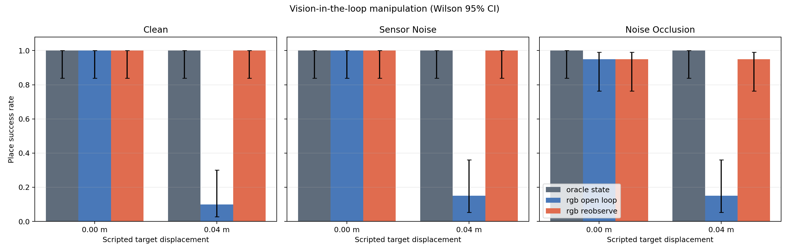
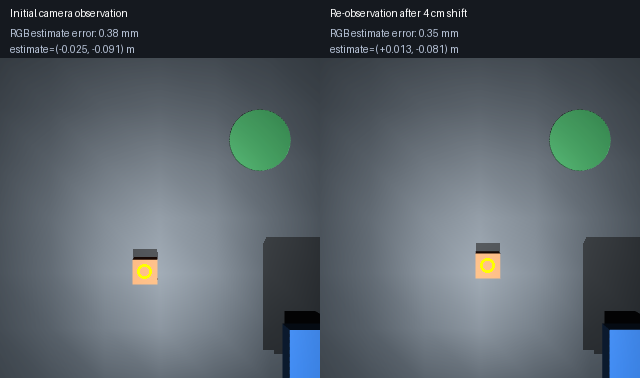
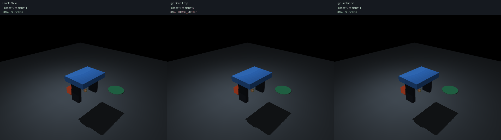
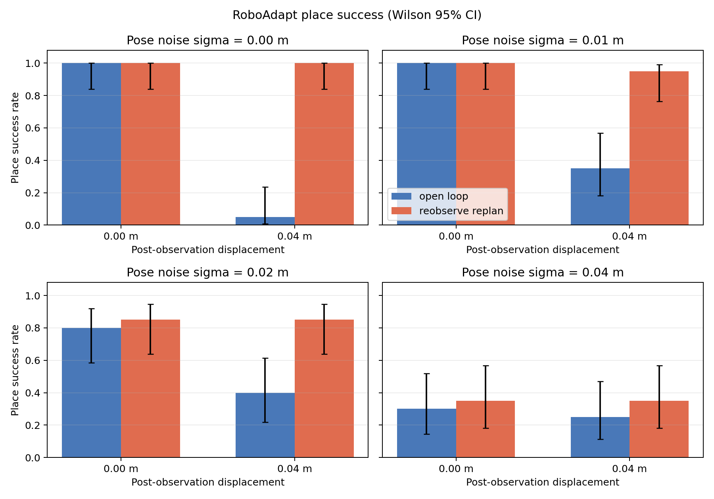
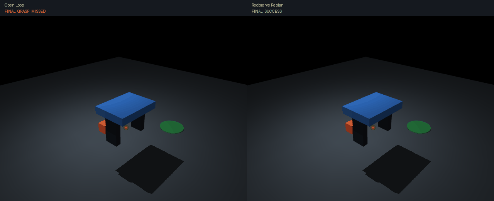

# RoboAdapt

**Robust pick-and-place control with a simulated 3-DOF Cartesian gantry gripper.**
This is a MuJoCo-only research project. It has not been tested on a physical robot, and
it does not claim real-world transfer. The v1.1 development line adds a genuine
rendered-RGB control path alongside the historical v1.0.1 truth-plus-noise benchmark.

The benchmark compares a one-observation `open_loop` policy with a bounded
`reobserve_replan` policy under paired seeds and post-observation object motion.
The original minimal robot is a 3-DOF Cartesian stage with two actuated fingers.
The 4 cm intervention directly changes the free cube's x/y state after observation
and before action to create a stale target; it is not a physical push. During
grasp and transport, the cube moves only through simulated contact.

The v1.1 vision benchmark compares an explicit simulator-state upper reference,
RGB open-loop control, and RGB re-observation/replanning. RGB controllers derive
their grasp target from top-camera pixels through color segmentation, centroid
extraction, calibrated ray/plane back-projection, and no object-pose truth. The
simulator state is used only to calculate evaluation errors and task outcomes.

## Windows quick start

Python 3.11–3.12 is declared; the v1.1.0 release acceptance was executed locally
on Python 3.12.14. In PowerShell:

```powershell
py -3.12 -m venv .venv
.\.venv\Scripts\python.exe -m pip install -r requirements.txt
.\.venv\Scripts\python.exe -m pip install .
.\.venv\Scripts\python.exe scripts\smoke_test.py
.\.venv\Scripts\python.exe -m pytest -q
```

If `py` is unavailable, create the environment with an explicit Python 3.11–3.12
executable. CUDA and a discrete GPU are not required for physics evaluation.

## Demo and evaluation

```powershell
.\.venv\Scripts\python.exe scripts\run_demo.py --seed 0 --controller open_loop
.\.venv\Scripts\python.exe scripts\run_demo.py --seed 0 --controller reobserve_replan --record
.\.venv\Scripts\python.exe scripts\run_benchmark.py --config configs\smoke.yaml --output results\smoke
.\.venv\Scripts\python.exe scripts\run_benchmark.py --config configs\benchmark.yaml --output results\final
.\.venv\Scripts\python.exe scripts\plot_results.py --input results\final\episodes.csv --output results\final\plots
.\.venv\Scripts\python.exe scripts\analyze_results.py --input results\final\episodes.csv --output results\final\analysis.json
.\.venv\Scripts\python.exe scripts\compare_demo.py --seed 0 --displacement 0.04
.\.venv\Scripts\python.exe scripts\rgb_sensor_demo.py --seed 0 --output media\rgb_detection.png
.\.venv\Scripts\python.exe scripts\evaluate_rgb_sensor.py --seeds 20 --output results\rgb\observations.csv
.\.venv\Scripts\python.exe scripts\run_vision_benchmark.py --config configs\vision_smoke.yaml --output results\vision_smoke
.\.venv\Scripts\python.exe scripts\run_vision_benchmark.py --config configs\vision_benchmark.yaml --output results\vision_v1.1
.\.venv\Scripts\python.exe scripts\analyze_vision_results.py --input results\vision_v1.1\episodes.csv --output results\vision_v1.1\analysis.json
.\.venv\Scripts\python.exe scripts\plot_vision_results.py --input results\vision_v1.1\episodes.csv --output results\vision_v1.1\plots
.\.venv\Scripts\python.exe scripts\compare_vision_demo.py --seed 0 --displacement 0.04
```

`run_demo.py --record` uses the real MuJoCo renderer and writes a GIF. Headless
physics tests and benchmarks do not create an OpenGL context.

The RGB controller uses a fixed calibrated top camera, orange-color centroid, and
known-plane back-projection. It is classical geometric vision, not a learned
detector. The v1.1 benchmark is RGB-in-the-loop, but it is not real-camera,
inverse-kinematics, reinforcement-learning, VLA, or Panda-arm validation.

## Evidence and scope

- Success means the free cube is lifted above a threshold, transported, released,
  and settled inside the goal. No weld/equality constraint or success-only bypass
  attaches it to the gripper.
- Each CSV row records condition, seed, controller, observation/replan counts,
  grasp/place outcomes, timing, error, failure reason, commit, and scene hash.
- `model_hash` is the first 16 hexadecimal characters of SHA-256 after normalizing
  text newlines to LF. `.gitattributes` also forces LF for XML assets, so Windows
  and Unix archives reconstruct the recorded `498e7b75553ad823` identifier.
- Figures are generated only from CSV data. See `docs/METHOD.md`,
  `docs/EXPERIMENTS.md`, and `docs/LIMITATIONS.md`.

License: MIT for project code/assets. MuJoCo is an Apache-2.0 dependency; see
`NOTICE.md`.

## Reproduced results

### v1.1.0 release candidate: rendered RGB in the control loop

The independent v1.1 run contains 360 episodes (20 base seeds reused across 3 visual
conditions × 2 displacement levels × 3 controllers). This yields 120 matched
scenarios, not 120 independent random geometry seeds. Oracle state succeeded in 120/120,
RGB open loop in 67/120 (55.8%), and RGB re-observation/replanning in 118/120
(98.3%). The paired RGB improvement is +42.5 percentage points; the exploratory
seed-cluster bootstrap interval is +35.0 to +49.2 points. RGB re-observation used
27.3% more mean episode physics steps across all trials. This is not pure image
processing cost: many open-loop failures terminate before transport and placement.
Within the 67 pairs where both methods succeeded, re-observation added exactly 50
physics steps (`0.10 s` simulated time) per pair. Two re-observation episodes failed
because the seeded image occluder prevented the initial cube detection.







Here “visual feedback” means a second simulated top-view RGB observation and
pre-grasp replanning, not continuous visual servoing during motion. These are
simulation results from a deliberately clean color/geometry pipeline with one
orange cube, a fixed calibrated camera, known plane height, fixed lighting, and
specified synthetic noise/occlusion.
See `docs/VISION_V1.1_REPORT.md` and `results/vision_v1.1/analysis.json` for the
method, condition-level results, exploratory statistics, and limitations. The
adaptive threshold variant was also explored in 120 episodes (60 matched scenarios)
and matched fixed re-observation at 58/60 successes each, so no adaptive improvement
is claimed. Its original CSV, metadata, config, and audit summary are retained in
`results/vision_adaptive_pilot/`. The rows record base commit `2cada2c` because the
vision code was then uncommitted; the exact dirty source snapshot cannot be
reconstructed, so this pilot is supporting exploratory evidence only.

### v1.0.1 historical truth-plus-noise benchmark

The checked-in final run contains 320 physics episodes (20 seeds × 4 noise
levels × 2 displacement levels × 2 controllers), all using scene hash
`498e7b75553ad823`. Aggregate place success was 83/160 (51.9%, Wilson 95% CI
44.2–59.5%) for open loop and 127/160 (79.4%, 72.5–84.9%) for re-observe/re-plan.
Without scripted displacement, results were 62/80 (77.5%) versus 64/80 (80.0%);
with 4 cm displacement they were 21/80 (26.25%) versus 63/80 (78.75%). The main
aggregate gain therefore reflects stale-target recovery. At 4 cm sensing noise,
condition rates were only 25–35%. Feedback corrected target
motion well, but it did not remove severe measurement noise.



The adaptive controller used about 25.3% more physics steps (2,794 vs 2,231 per
episode on average). See `results/final/episodes.csv`, `metadata.json`, and the
complete report for condition-level data and limitations.



The panels use the same seed and scripted 4 cm pre-action state displacement. The
left open-loop trial misses the grasp; the right re-observation trial succeeds.
