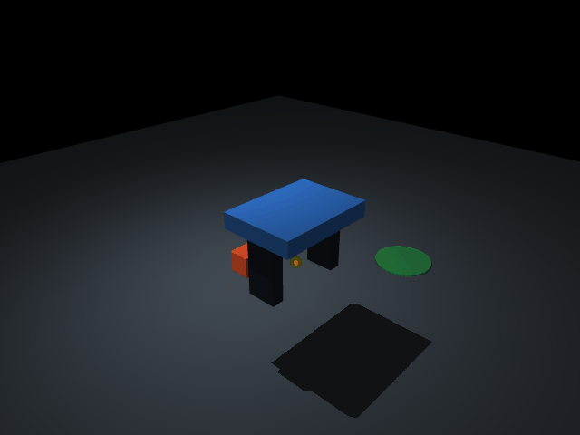

# RoboAdapt

**Robust contact-based manipulation under pose uncertainty in MuJoCo.** This is a
simulation-only research project. It has not been tested on a physical robot, and
its Level-0 perception input is simulator pose plus controlled synthetic noise—not
an RGB vision system.

The benchmark compares a one-observation `open_loop` policy with a bounded
`reobserve_replan` policy under paired seeds and post-observation object motion.
The original minimal robot is a 3-DOF Cartesian stage with two actuated fingers;
the cube remains a free body and is moved only through contact during grasp/place.

## Windows quick start

Python 3.10–3.12 is recommended. In PowerShell:

```powershell
py -3.11 -m venv .venv
.\.venv\Scripts\python.exe -m pip install -r requirements.txt
.\.venv\Scripts\python.exe -m pip install -e .
.\.venv\Scripts\python.exe scripts\smoke_test.py
.\.venv\Scripts\python.exe -m pytest -q
```

If `py` is unavailable, create the environment with any explicit Python 3.10+
executable. CUDA and a discrete GPU are not required for physics evaluation.

## Demo and evaluation

```powershell
.\.venv\Scripts\python.exe scripts\run_demo.py --seed 0 --controller open_loop
.\.venv\Scripts\python.exe scripts\run_demo.py --seed 0 --controller reobserve_replan --record
.\.venv\Scripts\python.exe scripts\run_benchmark.py --config configs\smoke.yaml --output results\smoke
.\.venv\Scripts\python.exe scripts\run_benchmark.py --config configs\benchmark.yaml --output results\final
.\.venv\Scripts\python.exe scripts\plot_results.py --input results\final\episodes.csv --output results\final\plots
.\.venv\Scripts\python.exe scripts\rgb_sensor_demo.py --seed 0 --output media\rgb_detection.png
.\.venv\Scripts\python.exe scripts\evaluate_rgb_sensor.py --seeds 20 --output results\rgb\observations.csv
```

`run_demo.py --record` uses the real MuJoCo renderer and writes a GIF. Headless
physics tests and benchmarks do not create an OpenGL context.

The optional RGB demo uses a fixed calibrated top camera, orange-color centroid,
and known-plane back-projection. It is classical geometric vision, not a learned
detector; the formal controller benchmark remains Level 0 (truth plus noise).

## Evidence and scope

- Success means the free cube is lifted above a threshold, transported, released,
  and settled inside the goal. No weld/equality constraint or success-only bypass
  attaches it to the gripper.
- Each CSV row records condition, seed, controller, observation/replan counts,
  grasp/place outcomes, timing, error, failure reason, commit, and scene hash.
- Figures are generated only from CSV data. See `docs/METHOD.md`,
  `docs/EXPERIMENTS.md`, and `docs/LIMITATIONS.md`.

License: MIT for project code/assets. MuJoCo is an Apache-2.0 dependency; see
`NOTICE.md`.

## Reproduced results

The checked-in final run contains 320 physics episodes (20 seeds × 4 noise
levels × 2 displacement levels × 2 controllers), all using scene hash
`498e7b75553ad823`. Aggregate place success was 83/160 (51.9%, Wilson 95% CI
44.2–59.5%) for open loop and 127/160 (79.4%, 72.5–84.9%) for re-observe/re-plan.
This aggregate should not hide the important boundary: at 4 cm sensing noise the
rates were only 30–35%, with or without displacement. Feedback corrected target
motion well, but it did not remove severe measurement noise.


The adaptive controller used about 25.3% more physics steps (2,794 vs 2,231 per
episode on average). See `results/final/episodes.csv`, `metadata.json`, and the
complete report for condition-level data and limitations.


